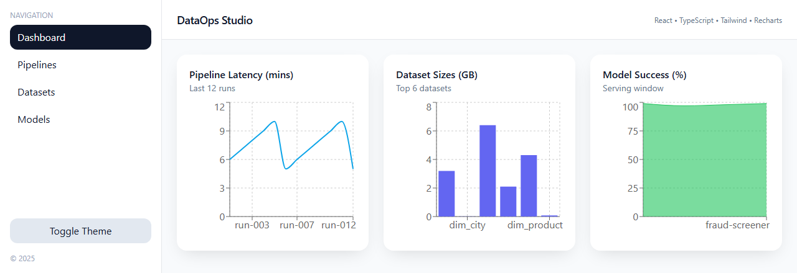
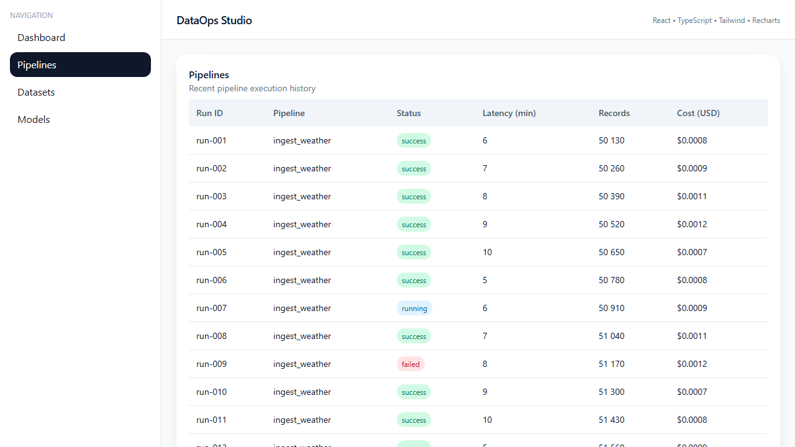
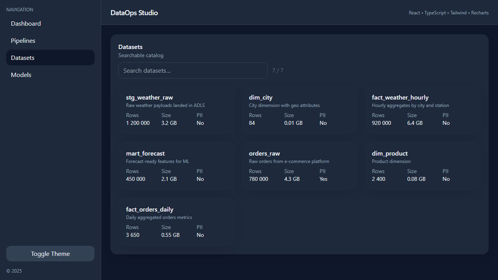

# DataOps Studio

A front-end prototype of a monitoring dashboard for a data team: pipeline
runs, a dataset catalog and a model registry, on one screen. Built with
React, TypeScript, Tailwind CSS and Recharts.

It runs on sample data. The numbers come from three JSON files in
`src/data/`, not from live pipelines. The aim was to design the screens a
data platform team would need, ready to be wired to a real backend.



## Pages

- **Dashboard:** three charts: latency of the last 12 pipeline runs,
  sizes of the six largest datasets, and the success rate of each served
  model.
- **Pipelines:** a table of 24 runs with status badges (success, running,
  failed), latency, record count and cost.
- **Datasets:** a catalog of 7 tables you can search by name, each with row
  count, size and a flag for personal data (PII).
- **Models:** cards for 4 models with version, latency, request count and
  success rate.

A button in the sidebar switches between light and dark themes.





## How to run it

You need Node.js 18 or later.

```bash
git clone https://github.com/Letsapatiiso07/dataops-studio.git
cd dataops-studio
npm install
npm run dev
```

Then open http://localhost:5173. `npm run build` type-checks the code and
writes a static site to `dist/`.

## How it is built

```
src/
  App.tsx         page switching and the theme toggle
  components/     Layout, Sidebar, Header, Card
  pages/          Dashboard, Pipelines, Datasets, Models
  data/           sample data: pipelines.json, datasets.json, models.json
```

Each page imports its JSON file directly and renders it, so swapping a JSON
import for a `fetch` call to an API is the only change a page needs to show
real data.

## Next steps

- Connect the pages to a real backend (for example FastAPI) instead of the
  JSON files.
- Add URL routing, so each page has its own link and the back button
  works. Today the current page is held in React state.
- Split the charting library into its own chunk; the build is about 550 kB
  of JavaScript.
- Deploy the static build to GitHub Pages.

## Author

Tiiso Letsapa, Letsapamyron07@gmail.com
